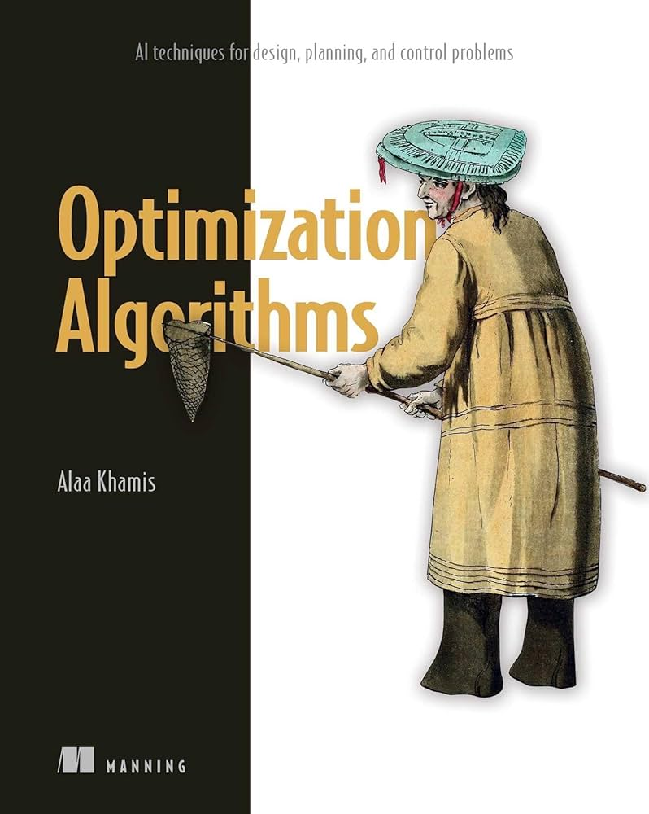

[](https://optimization-algorithms-book.github.io/Code-Listings/)
[](https://github.com/Optimization-Algorithms-Book/Code-Listings/tree/main/LICENSE)


# Optimization Algorithms: AI techniques for design, planning, and control problems

> ### 🌐 [Visit the book’s website](https://optimization-algorithms-book.github.io/Code-Listings/)

<a href="https://www.manning.com/books/optimization-algorithms">
</a>

This book is written for practitioners interested in solving ill-structured search and optimization problems using modern derivative-free algorithms. It will get you up to speed with the core concepts of search and optimization and give you the ability to handle practical design, planning and control problems.

Without assuming any prior knowledge of search and optimization, and with only an intermediate knowledge of data structures and Python, this book is designed to take anyone from never having solved search and optimization problems to being a well-rounded practitioner. You will be able to select, implement, and adapt the right solver for the right problem.

**At a glance:** 5 parts · 12 chapters · 3 appendices · 136 Python notebooks · 13 interactive labs

**Quick links:**
[📘 Get the book (Manning)](https://www.manning.com/books/optimization-algorithms) ·
[🌐 Website](https://optimization-algorithms-book.github.io/Code-Listings/) ·
[🏝️ Treasure-Hunting Mission](https://optimization-algorithms-book.github.io/Code-Listings/Chapter%202/Treasure_Hunting_Mission.html) ·
[🎥 Video summary](https://www.youtube.com/watch?v=RAVFSvgks3Q) ·
[🛠 Errata](errata.md) ·
[🔖 Cite](#-citation)

<br clear="right">

## 📑 Contents

Each chapter folder holds the book’s code listings as Jupyter notebooks that run in Google Colab, plus an interactive browser lab with simulations of the chapter’s examples and a from-scratch Python companion notebook.

### Part I: Deterministic search algorithms

| Chapter | Code | Interactive lab |
|---|---|---|
| 1. Introduction to search and optimization | [Chapter 1](Chapter%201) | [Optimization Basics Lab](https://optimization-algorithms-book.github.io/Code-Listings/Chapter%201/Ch1_Lab.html) |
| 2. A deeper look at search and optimization | [Chapter 2](Chapter%202) | [Problems and Algorithms Lab](https://optimization-algorithms-book.github.io/Code-Listings/Chapter%202/Ch2_Lab.html) · [Treasure-Hunting Mission](https://optimization-algorithms-book.github.io/Code-Listings/Chapter%202/Treasure_Hunting_Mission.html) |
| 3. Blind search algorithms | [Chapter 3](Chapter%203) | [Blind Search Lab](https://optimization-algorithms-book.github.io/Code-Listings/Chapter%203/BS_Lab.html) |
| 4. Informed search algorithms | [Chapter 4](Chapter%204) | [Informed Search Lab](https://optimization-algorithms-book.github.io/Code-Listings/Chapter%204/IS_Lab.html) |

### Part II: Trajectory-based algorithms

| Chapter | Code | Interactive lab |
|---|---|---|
| 5. Simulated annealing | [Chapter 5](Chapter%205) | [Simulated Annealing Lab](https://optimization-algorithms-book.github.io/Code-Listings/Chapter%205/SA_Lab.html) |
| 6. Tabu search | [Chapter 6](Chapter%206) | [Tabu Search Lab](https://optimization-algorithms-book.github.io/Code-Listings/Chapter%206/TS_Lab.html) |

### Part III: Evolutionary computing algorithms

| Chapter | Code | Interactive lab |
|---|---|---|
| 7. Genetic algorithms | [Chapter 7](Chapter%207) | [Genetic Algorithm Lab](https://optimization-algorithms-book.github.io/Code-Listings/Chapter%208/GA_Lab.html) (Chapters 7 and 8) |
| 8. Genetic algorithm variants | [Chapter 8](Chapter%208) | [Genetic Algorithm Lab](https://optimization-algorithms-book.github.io/Code-Listings/Chapter%208/GA_Lab.html) |

### Part IV: Swarm intelligence algorithms

| Chapter | Code | Interactive lab |
|---|---|---|
| 9. Particle swarm optimization | [Chapter 9](Chapter%209) | [Particle Swarm Optimization Lab](https://optimization-algorithms-book.github.io/Code-Listings/Chapter%209/PSO_Lab.html) |
| 10. Other swarm intelligence algorithms to explore | [Chapter 10](Chapter%2010) | [Ant Colony Optimization Lab](https://optimization-algorithms-book.github.io/Code-Listings/Chapter%2010/ACO_Lab.html) |

### Part V: Machine learning-based methods

| Chapter | Code | Interactive lab |
|---|---|---|
| 11. Supervised and unsupervised learning | [Chapter 11](Chapter%2011) | [Intro to ML Lab](https://optimization-algorithms-book.github.io/Code-Listings/Chapter%2011/IntroML_Lab.html) · [Unsupervised Learning Lab](https://optimization-algorithms-book.github.io/Code-Listings/Chapter%2011/UL_Lab.html) · [Supervised Learning Lab](https://optimization-algorithms-book.github.io/Code-Listings/Chapter%2011/SL_Lab.html) |
| 12. Reinforcement learning | [Chapter 12](Chapter%2012) | [Reinforcement Learning Lab](https://optimization-algorithms-book.github.io/Code-Listings/Chapter%2012/RL_Lab.html) |

### Appendices

| Appendix | Code |
|---|---|
| A. Search and optimization libraries in Python | [Appendix A](Appendix%20A) |
| B. Benchmarks and datasets | [Appendix B](Appendix%20B) |
| C. Exercises and solutions | [Appendix C](Appendix%20C) |

## 🚀 Getting started

- **In the browser:** open any notebook in its chapter folder and click the **Open in Colab** badge; nothing to install.
- **On your machine:** clone the repository and install the dependencies, including the book’s helper package `optalgotools`:
  ```bash
  git clone https://github.com/Optimization-Algorithms-Book/Code-Listings.git
  cd Code-Listings
  pip install -r requirements.txt
  ```

> **Note:** If you downloaded the code bundle from the Manning website, check this [official repository](https://github.com/Optimization-Algorithms-Book/Code-Listings) for the most recent version.

## 🎥 Video summary

[](https://www.youtube.com/watch?v=RAVFSvgks3Q)

Click the thumbnail to watch on YouTube.

## 💬 Testimonials

> "*Elegantly covers modern optimization algorithms in depth and breadth. A great resource.*"
>
> **Ajit Jaokar**, Course Director at [University of Oxford](https://www.conted.ox.ac.uk/tutors/4164)

> "*A treasure trove. Perfect for anyone looking to navigate the intricate world of optimization in real-world scenarios.*"
>
> **Sergei Kalinin**, Weston Fulton Professor at [University of Tennessee](https://tickle.utk.edu/mse/faculty/sergei-kalinin/)

> "*An exceptional book on the most prominent optimization algorithms.*"
>
> **Maxim Volgin**, Data Scientist at [KLM Royal Dutch Airlines](https://nl.linkedin.com/in/maxvol)

> "*This little gem introduces the reader to the algorithms and how you should apply them to real-world problems. A must-read!*"
>
> **Marcello La Rocca**, author of [Grokking Data Structures and Advanced Algorithms and Data Structures](https://github.com/mlarocca)

## 🛠 Errata

Found a mistake? See the [errata](errata.md).

## 🔖 Citation

Plain text (IEEE style):

Alaa Khamis. *Optimization Algorithms: AI techniques for design, planning, and control problems*. Manning Publications, ISBN 978-1633438835, 2024.

BibTeX:
```bibtex
@book{Khamis2024,
  title     = {Optimization Algorithms: AI techniques for design, planning, and control problems},
  author    = {Alaa Khamis},
  year      = {2024},
  isbn      = {978-1633438835},
  publisher = {Manning Publications}
}
```
